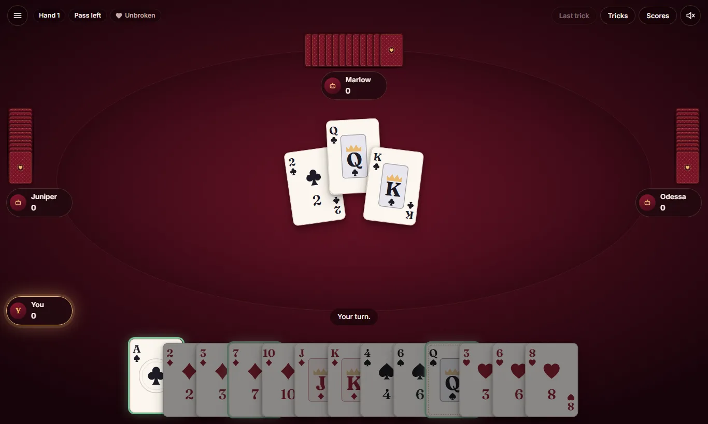
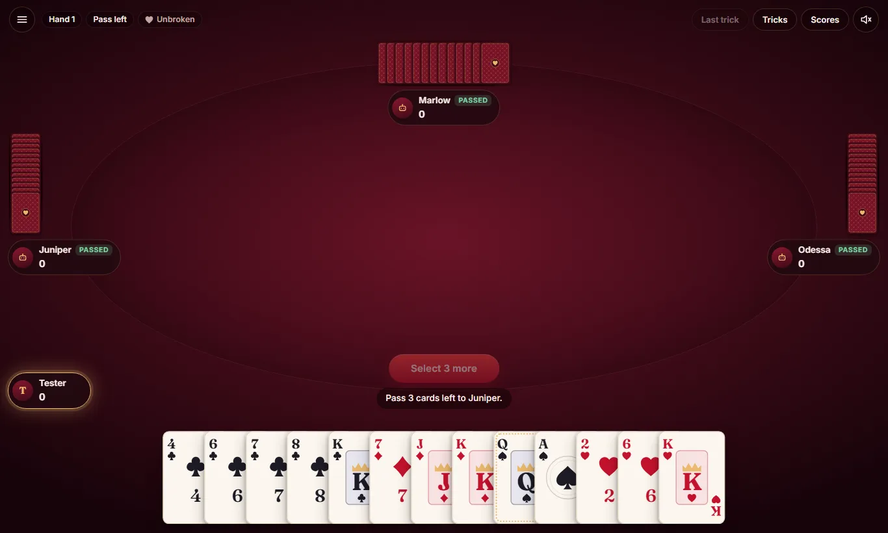
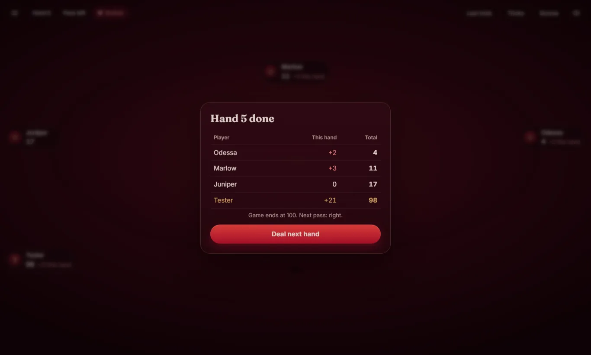
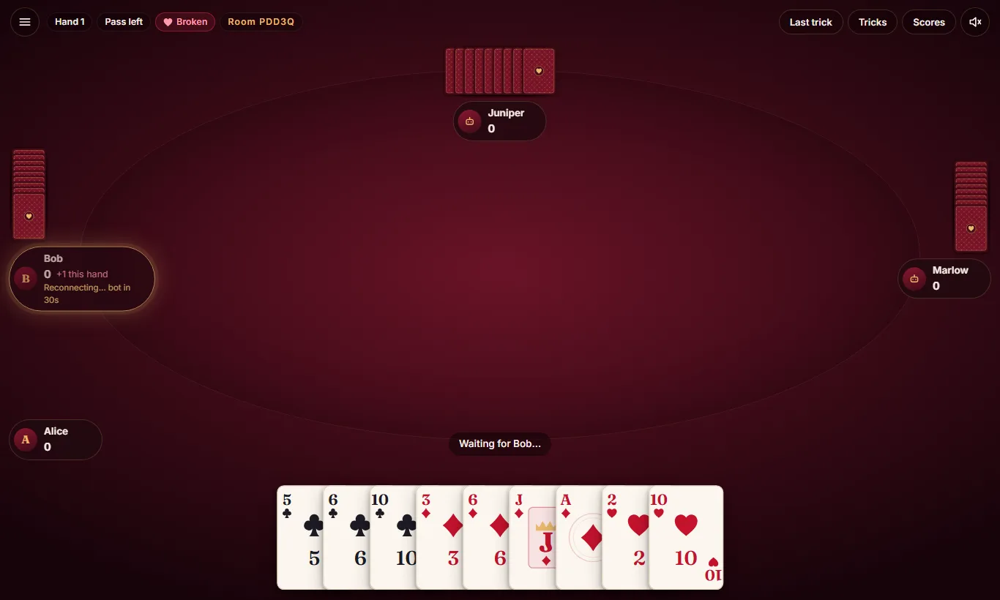
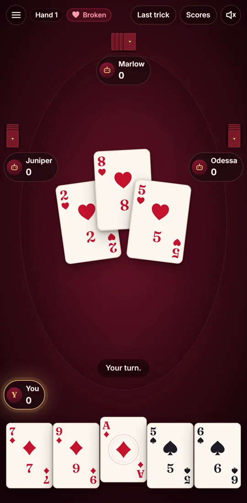
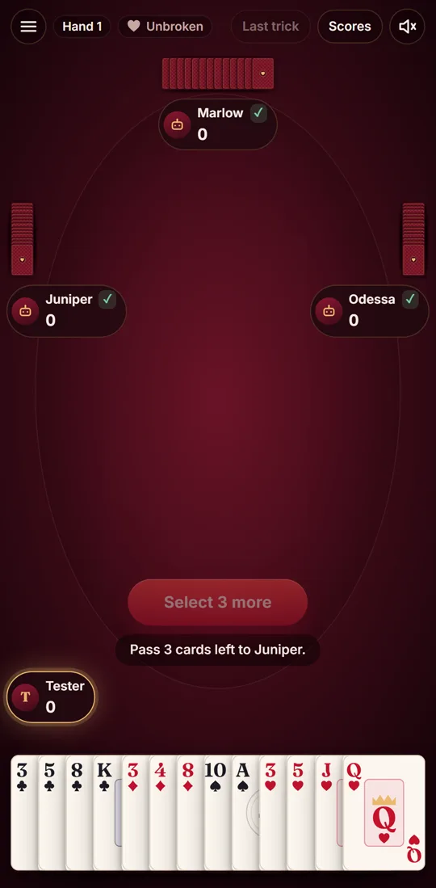

# Hearts

The classic four-player trick-dodging card game in the browser. Play three bots at Easy, Normal or Hard, or open a room and play friends online, with bots filling any empty seats.

**Status: complete, deployed and playable.** It has been played through by scripted browser runs and by hand in a browser, but not yet by real groups of players or on a physical phone.

**Play it:** https://hearts-kappa-eight.vercel.app

Online rooms use a free server that sleeps when nobody is playing. The first connection can take up to a minute, and the game says "Waking server…" while it waits. Playing the bots works instantly and needs no server.



| Passing | Hand summary | Online: a player dropped |
|---|---|---|
|  |  |  |

| Phone: a trick | Phone: passing |
|---|---|
|  |  |

Screenshots come from `node scripts/screenshots.mjs <url>` and the browser test runs below.

## How to play

Standard four-player Hearts:

- **Goal:** take as few points as possible. Each heart is 1 point and the queen of spades (Q♠) is 13.
- **Passing:** before each hand everyone passes three cards: left, then right, then across, then a hand with no pass, and repeat.
- **Tricks:** the 2♣ leads the first trick. Follow the led suit if you can, otherwise play anything. The highest card of the led suit wins and leads next.
- **First trick:** no hearts and no Q♠, unless your hand holds nothing else.
- **Breaking hearts:** hearts can't be led until a heart has been played (or the Q♠, see below), unless you hold only hearts.
- **Shooting the moon:** take all 13 hearts and the Q♠ and every other player takes 26 instead.
- **End:** when someone reaches the target score the game ends and the lowest score wins. A tie for lowest is a shared win.

Tap a dimmed card to see why it can't be played. **Last trick** replays the previous trick, **Tricks** lists every trick of the hand, and **Scores** shows the running scoreboard of every hand.

### House rules

Set on the home screen for solo games, and by the host in an online room.

| Rule | Default |
|---|---|
| Game ends at 50, 75, 100 or 150 | **100** |
| Moon shooter may choose −26 to themselves instead of +26 to everyone else | **off** (always +26 to the others) |
| J♦ is worth −10 to whoever takes it | **off** |
| Q♠ breaks hearts | **on** |

## Bots

- **Easy** plays its lowest card when following, throws its highest-ranked card when void (often not the dangerous one), passes its three highest cards, and plays a random legal card one time in five.
- **Normal** uses rules of thumb: ducks under the winning card, drops the Q♠ under the A♠ or K♠, leads low from safe suits, smokes out the queen with low spades, voids short suits when passing, guards a well-protected queen, and tries to stop an opponent who is running away with every point.
- **Hard** counts cards and tracks which players are void in which suits (and which cards it passed to whom). For every decision it deals the unseen cards many times, consistent with everything it knows (120 sampled deals per move in the browser), plays each candidate card out to the end of the hand with the Normal policy, and picks the card with the best average result. While nobody else has taken a point it also simulates trying to shoot the moon itself, so it attempts the moon when its hand supports it and defends against yours.

### Simulation

`npm run sim -- 200 64` plays 200 full games (to 100 points) per matchup, rotating seats every game so seat position favours nobody. Hard used 64 sampled deals per move in this run. Measured on 2026-11-26:

| Table | Points per hand | Games won per seat (fair share 25%) | Moons shot |
|---|---|---|---|
| 1 Hard vs 3 Easy | Hard **3.13**, Easy 8.74 | Hard **85.5%**, Easy 4.8% | Hard 71, Easy 49 (1,859 hands) |
| 2 Hard vs 2 Easy | Hard **5.05**, Easy 10.91 | Hard **47.5%**, Easy 2.5% | Hard 148, Easy 39 (1,645 hands) |
| 1 Normal vs 3 Easy | Normal **3.75**, Easy 7.86 | Normal **75.0%**, Easy 8.3% | Normal 6, Easy 45 (2,019 hands) |
| 1 Hard vs 3 Normal | Hard **4.48**, Normal 9.38 | Hard **80.8%**, Normal 6.4% | Hard 219, Normal 15 (1,836 hands) |

Hard clearly beats both Easy and Normal. Normal's moon defence is weak: Hard shot the moon in about one hand in eight against it.

## Online multiplayer

- Create a room and share the five-letter code or the invite link (`?room=CODE`). Two to four people can play; when the host starts, bots (at the room's difficulty) take the empty seats.
- The server is authoritative: it deals, validates every pass and play, and sends each player only their own hand. Other hands are reduced to card counts.
- **Refresh or drop:** your seat is held for 30 seconds while you reconnect, with a countdown shown to the others. A refresh keeps your seat (the seat token is stored per browser tab).
- **Bot takeover:** if you don't come back in time, a bot plays your seat. You can still return and take it back. If you choose **Leave**, a bot takes the seat for the rest of the game. Someone new can join a game in progress by taking over a bot's seat.
- If a connected player does nothing for 75 seconds, a bot makes that one move for them so the table never stalls. The hand summary deals on when everyone has clicked continue, or after 12 seconds.

## How it works

| Part | Where | Notes |
|---|---|---|
| Rules engine | `src/engine/` | Pure functions over an immutable state: deal (seeded PRNG), pass, legal plays, tricks, scoring, the moon, game end. `viewFor` builds what one seat may see. |
| Bots | `src/bots/` | `heuristic.ts` (Normal, and the rollout policy), `bots.ts` (Easy, passing, moon choice, Hard's Monte Carlo search), `simulate.ts` (bot-vs-bot matches). |
| Server | `server/server.ts` | Node + Socket.IO. Rooms, seats, reconnect tokens, takeover timers, bot pacing. Imports the same engine and bots as the client. |
| Client | `src/App.tsx`, `src/ui/`, `src/net/` | React + Vite. Card faces, suit shapes and card backs are SVG drawn for this project. Sounds are synthesised with the Web Audio API; there are no audio files. |

Hosting: the client is a Vercel static site that deploys on every push to `main`. The server is a free Render web service (`hearts-server`, https://hearts-server-jzus.onrender.com, health check at `/health`) that also deploys on every push to `main`. Free Render services sleep after about 15 minutes without traffic; the first request then takes up to about a minute, and rooms in memory are lost when the server sleeps or redeploys.

## Run locally

```bash
npm install
npm run dev:multiplayer   # client on http://127.0.0.1:4290 and server on :4291
npm test                  # all unit, invariant, bot and server tests
npm run build             # type-check and build the client
npm run sim -- 40 48      # quick bot simulation (games, samples per move)
```

`npm run dev` alone runs just the client; solo play needs nothing else. The client talks to the local server when opened on localhost, and to the Render server everywhere else. Set `VITE_SERVER_URL` to override.

## Verification

Automated (`npm test`, 45 tests, Vitest):

- **Engine** (26): dealing, determinism by seed, every pass direction including the hold hand, invalid passes, the 2♣ lead, follow suit, no points on the first trick and its all-points exception, leading hearts before and after they break, the Q♠ house rule, trick winners, 26 points per hand, the moon with both choices, the J♦ house rule (including with the moon), the end of the game, custom targets, shared wins, and rule normalisation.
- **Random-play invariants** (3): 200 full random games across five house-rule combinations, checking card conservation, level hand sizes, hearts never led early, point totals per hand, moon arithmetic, scores matching history, pass rotation, the winner being lowest, and that player views never contain other hands.
- **Bots** (7): every difficulty plays complete legal games, passes are valid, strategic passing keeps a guarded queen and dumps a naked one, Normal and Hard drop the queen under a high spade, sampled deals respect hand sizes, voids and passed cards, the moon choice, and Hard beating Easy in a short seeded match.
- **Server** (9, over real Socket.IO connections): room create and join, hand privacy, rejected illegal passes and plays and out-of-turn moves, a complete game with two humans and two bots plus a rematch, reconnecting after a drop, bot takeover after the grace period and reclaiming the seat, leaving mid-game, host hand-off, and a full room refusing a fifth player.

Browser checks:

- `node scripts/e2e.mjs solo <url> desktop|phone [difficulty]` plays a full game to the end by clicking cards like a player (random legal choices), and fails on any console error. Run against the live site at desktop size (1366×820, Hard) and phone size (Pixel 7 emulation, Easy).
- `node scripts/e2e.mjs multi <url>` runs two browsers (desktop host, phone guest) against the deployed server: create a room, join by link, start with two bots, check the two hands are disjoint, play four tricks, refresh the guest and check the seat and hand come back, close the guest, see the reconnect countdown and the bot takeover, and finish the hand with the bot in that seat.
- Played by hand in a desktop browser and at phone width: passing, trick animations, illegal-card hints, last trick, scoreboard, hand summary, two-tab rooms, refresh and takeover.

Never tested: a physical phone or tablet, Safari or Firefox, how the sound effects actually sound on different devices, real groups of people playing online, and many simultaneous rooms on the free server.

## Known limitations

- Rooms live in the server's memory: a server sleep, restart or redeploy ends every open game.
- There are no accounts, chat or public matchmaking; rooms are private and joined by code.
- Names are free text (letters, numbers and a little punctuation, up to 16 characters) and are not moderated.
- When a disconnected player's turn comes up, the table waits for their 30-second grace period before the bot plays.
- Hard runs on the main thread in solo play. It takes tens of milliseconds per move on a laptop; a slow phone may pause briefly.
- The Normal bot defends badly against the moon.

## Story

Hearts is one of the most familiar card games there is, which makes it a good test of whether a small browser game can feel finished: correct rules, opponents worth playing, friends online, and a table that looks good on a laptop and a phone. Zach asked for exactly that ("all the normal stuff, multiplayer, bots, vercel domain, github") in one sentence, and this project is the result of a single long build session. It reuses the server, room and deployment pattern from Zach's earlier [Remorse Chess](https://github.com/Zach-Shirley/remorse-chess).

## AI assistance and Zach's role

This was built by Claude Code (Anthropic's Claude Opus 5.5) working in Zach's environment: the rules engine, bots, server, client, art, sounds, tests, simulation, browser testing and deployment. Zach chose to build Hearts, set the scope and requirements (standard rules, house-rule toggles, bot difficulties, online rooms with reconnect and bot takeover, the free hosting model, an original visual style), and decided how it is published. As of publication Zach has not yet play-tested this version; problems found in that play-test will be fixed in later commits.

## Attribution

- Fonts: [Fraunces](https://github.com/undercasetype/Fraunces) and [Inter](https://github.com/rsms/inter), both under the SIL Open Font License 1.1, bundled through the Fontsource packages.
- Libraries: React, Vite, Socket.IO, TypeScript, Vitest, Playwright and tsx, each under its own license (MIT or Apache-2.0).
- Card faces, suit shapes, card backs, court emblems and all sounds were made for this project. No third-party art or audio is used.

## License

No license has been chosen yet. All rights reserved; source is public to read.
